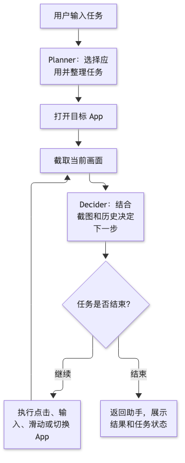

# 手机 Agent 实践：学生手册

本手册分为两部分：第一部分实现一个简单版本的“豆包手机 Agent”，通过聊天下发任务，让 Agent 操作手机并反馈结果；第二部分作为开放性作业，为 OpenHarmony（以下简称 OH）Agent 接入 DSH。

## 第一部分：实现通过聊天控制手机的最小 Agent

### 1.1 实验信息

| 项目 | 内容 |
| --- | --- |
| 实验名称 | 通过聊天控制手机的最小 Agent 实践 |
| 建议用时 | 4 小时，环境准备在课前完成 |
| 建议分组 | 2–3 人一组 |
| 前置知识 | 移动应用开发基础、网络请求、基础大模型 API 使用 |
| 目标平台 | 课程指定的 OH 开发板；参考设备为 SysLong RoboPi，OpenHarmony 5.1 / API 18 |
| 实验材料 | HarmonyOS 源工程、ClawMate OH 参考代码、[迁移提示词](../migration-validation/student-prompt.md)、设备执行模块与模型服务配置 |
| 交付物 | 源码、可安装 HAP、简短实验记录和实机演示 |

### 1.2 实验目标与范围

本实验参考豆包手机 Agent 通过对话操作手机的交互方式，从已有 HarmonyOS 工程出发，完成 OH 适配，做出一个能运行的最小版本。先通过资料检索和源码阅读理解两个版本的差异，形成迁移思路，再使用教师提供的提示词辅助完成修改。

现场不要求配备 HarmonyOS 设备，也不要求运行或验证 HarmonyOS 源版本；迁移后的运行验证在课程提供的 OH 开发板上完成。

用户在聊天界面输入一句任务，例如“打开备忘录，新建一条记录，写入‘今天完成了手机 Agent 实验’并保存”。Agent 接收任务后，观察当前界面，执行点击、输入或滑动等操作，直到完成任务或遇到无法继续的情况，再向用户反馈结果。

第一部分只要求打通以下闭环：

> 聊天输入任务 → 获取手机截图 → 模型决定下一步 → 执行手机操作 → 再次观察 → 在聊天中反馈结果

验收时选择一个目标 App 中的简单任务即可。重点是任务确实由聊天触发、手机确实执行了操作、反馈与实际结果一致。搜索、跨 App 信息整理、文件下载等不作为本部分的必做功能。

### 1.3 理解参考工程

GUI Agent 通过截图观察页面，让多模态模型决定下一步，再执行点击、输入或滑动。它通过界面完成操作，不要求目标 App 提供业务 API。

ClawMate 参考工程的执行流程如下：

<p align="center" style="text-align: center;">
  
</p>

其中，**Host** 是接收聊天指令和展示结果的助手 App，**Planner** 负责规划，**Decider** 负责根据截图决定操作。可以沿用已有分工，先跑通一条简单任务，无需扩展规划能力。

**Self-HDC** 指 App 连接本机调试服务执行设备操作。课程设备上运行时无需电脑代为点击，但模型请求仍需要可达的模型服务。**HAP** 是应用安装包。

阅读代码时，可以先看[任务循环](../entry/src/main/ets/core/AgentRunner.ets)、[设备执行入口](../entry/src/main/ets/core/PhoneBridge.ets)和[应用目录](../entry/src/main/ets/core/AppCatalog.ets)。设备执行模块可以复用，重点是理解并接通聊天、模型与设备操作之间的数据流。

### 1.4 实验环境与课前准备

#### 硬件与软件

| 项目 | 要求 |
| --- | --- |
| 开发板 | 使用课程镜像和已配置的 Self-HDC 执行环境；参考设备的调试 shell 为 root |
| 开发电脑 | 安装课程配套的 DevEco Studio、OpenHarmony SDK、Hvigor 和依赖工具 |
| 设备连接 | USB 调试可用，电脑能够执行 `hdc` 命令 |
| 模型服务 | Planner 可用文本模型；Decider 需要支持图片输入的多模态模型 |
| 目标 App | 选择一个可手动完成简单任务的 App，例如备忘录 |
| 中文输入 | 准备可用的中文输入法或键盘输入方案 |

SDK 与构建工具使用课程指定的配套版本。当前 OH 参考工程的编译版本为 API 23、最低兼容版本为 API 18；调用接口时仍需检查目标设备是否支持。

#### 设备检查

在电脑终端执行以下命令，先确认只连接了一台实验设备：

```sh
hdc list targets
hdc shell id
hdc shell 'command -v aa && command -v bm && command -v snapshot_display && command -v uitest && command -v base64'
hdc shell 'uitest uiInput help'
hdc shell 'netstat -lnt'
```

检查结果应包括设备标识、调试 shell 身份、各命令路径、触控命令帮助，以及课程配置的 Self-HDC 监听端口，默认使用 `8710`。若存在多个连接，后续命令用 `hdc -t <设备标识>` 指定目标。

对 App 而言，`127.0.0.1` 是开发板本身。Self-HDC 需要本机 `hdcd` 开启 TCP 监听；电脑能够通过 USB 连接设备，并不代表 App 已能连接 Self-HDC。未通过检查时，请助教按[设备配置说明](HDC_SELF_CONTROL.md)处理。

#### 工程与服务检查

1. 准备 `harmonyos-starter` 的独立副本，通过 README、代码地图和源码了解聊天、模型请求与设备执行的调用关系。
2. 确认课程指定的 OH SDK、构建工具与签名配置可用，准备好[迁移提示词](../migration-validation/student-prompt.md)。
3. 准备模型服务地址、模型名和密钥；OH 版本可运行后，再从开发板实际发送请求确认连接。
4. 在 OH 开发板上手动完成准备交给 Agent 的简单任务，确认目标 App 和中文输入可用。
5. 核对目标 App 在 OH 开发板上实际安装的包名和入口。

模型服务部署在电脑上时，App 应使用开发板能够访问的电脑地址，不能填写开发板的 `127.0.0.1`。

模型服务暂时不可用时，可以接入课程测试服务，以预设响应验证请求、动作执行和错误处理。预设动作不会随真实画面自动调整，最终验收需使用真实模型服务。

### 1.5 实现步骤

> 本阶段**禁止**直接复制参考仓库文件到你的工程。允许阅读，允许让 AI 帮你解释，不允许整文件搬运。课程提供的设备执行模块按实验材料说明复用。

#### 第一步：检索平台差异，理解迁移原理

通过官方文档、课程资料和源码了解 HarmonyOS 源版本与 OH 目标版本的区别。检索时注明平台、SDK/API 版本和目标设备，避免把不同版本的接口混在一起。

围绕下面的问题整理差异与迁移思路：

| 关注点 | 需要弄明白的问题 |
| --- | --- |
| 工程与构建 | 源工程使用什么 SDK、运行平台和设备类型？迁到课程 OH 环境时，哪些构建配置、依赖和签名需要调整？ |
| 系统接口 | 源工程用了哪些系统接口、权限和后台能力？目标 OH 版本是否支持，不支持时如何替换或降级？ |
| 设备执行 | 源工程如何把操作交给设备执行？迁移后如何通过 OH 本机 Self-HDC 完成截图、点击和输入？ |
| 应用启动与返回 | 如何确定 OH 开发板上目标 App 的包名和入口？任务结束后如何返回助手？ |
| 业务与平台的边界 | 聊天、模型决策和任务循环中，哪些逻辑可以保留，哪些位置需要接入新的平台实现？ |

结合源工程中的具体文件，写出“当前做法 → 目标环境要求 → 准备如何修改”，并记录资料来源。可以请 AI 解释代码和概念，但要能用自己的话说明任务从聊天输入到手机执行的完整链路。

**完成标志：** 形成一份简短的差异与迁移思路记录，能解释为什么需要修改、应改在哪一层，以及准备如何在 OH 设备上验证。此步骤以资料和源码分析为依据，无需运行 HarmonyOS 源版本。

#### 第二步：使用教师提示词完成 OH 迁移

1. 在 `harmonyos-starter` 的独立副本中打开 AI 编程助手，先提供上一步整理的差异与迁移思路。
2. 打开教师提供的[迁移提示词](../migration-validation/student-prompt.md)，将横线之间的内容交给 AI 编程助手执行，同时附上本次实验范围说明：

   > 本次按学生手册第一部分完成最小闭环：聊天接收任务、截图决策、手机操作与结果反馈。验收选择一个简单任务即可。提示词中的搜索、跨 App 查询和下载等额外功能不纳入本次实现与验收范围。迁移分析基于资料和源码，不要求运行或验证 HarmonyOS 源版本；运行验证在课程 OH 开发板上完成。

3. 让 AI 实际修改工程、编译并修复错误；结合自己的迁移思路检查修改，重点核对构建配置、兼容接口和设备执行实现。
4. 将生成的 HAP 签名并安装到 OH 开发板，检查冷启动、聊天页面和中文输入，发送一条消息确认模型请求与响应可用。

**完成标志：** 生成可安装的 OH HAP，App 冷启动、聊天输入和模型请求可用；能结合实际代码说明主要迁移修改及其原因。编译通过与 OH 实机通过分别记录。

#### 第三步：接通手机观察与操作

1. 接通 Self-HDC，获取当前屏幕截图，检查图片能否正常显示和解码。
2. 分别验证点击、文字输入、滑动等基础动作，确认坐标与实际屏幕一致。
3. 验证目标 App 的启动入口，为后续任务执行做好准备。

**完成标志：** 助手能获取真实截图，并通过设备执行模块完成基础操作。

#### 第四步：实现最小任务循环

1. 将用户任务和当前截图发送给模型，让模型返回下一步动作或任务结束状态。
2. 解析并校验动作，交给设备执行模块执行。
3. 操作后重新截图，再交给模型判断，循环推进任务。
4. 模型判断完成时结束循环；请求失败、动作无效或达到步数上限时停止，并记录原因。

**完成标志：** Agent 能根据操作后的新画面继续决策，完成一个需要连续操作的简单任务；执行过程有日志可查，循环有明确的结束条件。

#### 第五步：从聊天下发任务并反馈结果

1. 将聊天界面的发送操作接到任务循环，发送后显示任务正在执行。
2. 运行一条简单指令，例如：“打开备忘录，新建一条记录，写入‘今天完成了手机 Agent 实验’并保存。”也可以根据设备已有 App 选择难度相近的任务。
3. 执行结束后返回助手，在聊天中显示完成结果；失败时说明中断原因。
4. 提供停止入口，用户停止任务后不再执行新动作。

**完成标志：** 用户只需在聊天中下发任务，Agent 即可自动执行并反馈结果，中途无需人工代为点击或输入。

### 1.6 验收与提交

在 OH 开发板上按“启动助手 → 在聊天中输入任务 → Agent 操作目标 App → 返回助手反馈结果”的顺序演示，并核对目标 App 中的实际结果。以备忘录任务为例，重新打开后应能找到保存的记录，文字内容与指令一致。

验收检查：

- **理解迁移：** 能根据资料和源码说明两个版本的主要差异，以及实际修改如何对应迁移思路。
- **聊天触发：** 能输入中文任务并启动执行。
- **自动操作：** 通过截图与模型决策完成连续操作，演示过程中无需人工接管。
- **结果真实：** 目标 App 中能核对任务结果，聊天中的完成提示与实际结果一致。
- **能够结束：** 任务完成、失败、达到步数上限或用户停止时，执行循环能退出；停止后不执行迟到响应中的动作。

最终提交：

- 源码和可安装的 HAP。
- 一段约 3 分钟的实机演示，展示一条完整任务和一次停止或失败反馈。
- 简短实验记录：平台差异与资料来源、迁移思路、提示词辅助完成的主要修改、OH 运行环境、任务循环的数据流与验收结果；如有未通过项，说明现象和原因。

### 1.7 AI 编程协作建议

可以使用 AI 编程助手辅助阅读代码、修改和排错，按“提出一个小目标 → 修改 → 编译或运行 → 核对结果”的顺序推进。

1. **小步提交：** 每打通一个环节提交一次代码，说明修改内容和验证结果。
2. **先读再改：** 让 AI 先解释相关代码和修改范围；新增模块时先确认接口与输入输出。
3. **提供有效报错：** 保留首个有效错误、相关代码、环境信息和期望行为，让 AI 解释原因后再修改。
4. **复核生成代码：** 能说明关键代码的输入、输出、失败处理，以及为什么适用于当前 OH 设备。
5. **保留代表性记录：** 选两次有价值的 AI 协作过程，简述建议、你的判断与实际验证结果。
6. **保护配置：** 密钥放在本地配置中并排除提交；截图、日志和演示中不展示完整密钥。

遇到自动化故障时，按“设备连接 → 截图与动作 → 模型响应与解析 → 任务循环与收尾 → 聊天界面展示”的顺序定位。

### 1.8 常见问题

**Q1：安装 HAP 时提示签名不匹配？**

先核对已安装 App 与新 HAP 的包名、证书和签名配置。覆盖安装应使用匹配签名；需保留原 App 时使用分配的新包名，避免直接卸载造成数据丢失。

**Q2：电脑能连设备，App 却连不上 `127.0.0.1:8710`？**

USB 调试和本机 TCP 连接是两条通路。检查 `hdcd` 的 TCP 监听端口、App 中的地址与端口，以及设备授权。端口未监听时请助教检查设备配置；认证失败时保留具体错误信息。

**Q3：截图黑屏、内容不完整或点击位置不对？**

先打开原始截图检查目标画面能否正常显示和解码，再核对屏幕方向、物理分辨率与动作坐标。模型看到的缩略图尺寸可能与实际屏幕不同。命令出现警告文本时，结合执行结果和实际图片判断。

**Q4：中文输入乱码，或者外接键盘只能输入英文？**

自动输入乱码先检查文本编码、命令引号和特殊字符转义；手动拼音输入需要设备安装中文输入法并完成切换。这两种问题分开排查。

**Q5：模型返回代码块或不完整 JSON，解析失败？**

记录原始响应，先去除代码块包装，再按动作结构校验必需字段、参数和取值。解析失败时重试或报告错误，不要执行猜测补出的动作。可以参考已有解析模块处理响应。

**Q6：App 切到后台后任务停止，或结束后回不到助手？**

检查后台任务申请结果和临时运行额度，核对返回入口、包名及任务清理顺序。额度到期时应停止后续操作并展示原因。返回失败应记录日志，保留原任务结果。

**Q7：模型请求连接失败或一直等待？**

核对服务地址、密钥、模型名和设备网络，区分连接失败、鉴权失败与响应超时。电脑能访问服务不代表开发板也能访问。重试前恢复界面状态，点击停止后不再执行迟到响应中的动作。

## 第二部分：为 OH Agent 接入 DSH（开放性作业）
