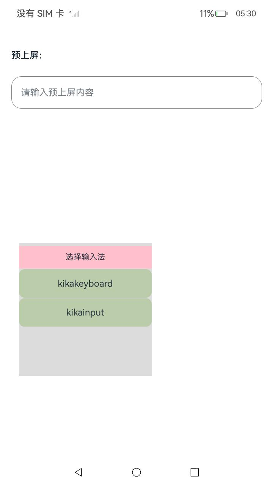

# Kika输入法应用

### 介绍
本示例使用[inputMethodEngine](https://gitee.com/openharmony/docs/blob/master/zh-cn/application-dev/reference/apis-ime-kit/js-apis-inputmethodengine.md)实现一个轻量级输入法应用kikaInput，支持在运行OpenHarmony OS的智能终端上。

### 效果预览

|               主键盘               |             菜单             |                 编辑                 |                 预上屏                 |
| :---------------------------------------: | :---------------------------------------: | :--------------------------------------: |:--------------------------------------: |
|        |  |  | 

使用说明

1.使用hdc shell aa start ability -a InputMethod -b cn.openharmony.inputmethodchoosedialog命令拉起切换输入法弹窗，点击kikainput切换输入法到当前应用。

2.点击应用中的编辑框，拉起输入法键盘。

3.点击键盘可以在编辑框中输入内容，点击回退键可以删除文本。

4.点击左上角的键盘图标可以进入二级菜单，当前只有编辑菜单。

5.点击编辑可以进入编辑状态，点击方向键可以移动光标。

6.编辑状态点击选择按钮，进入选择状态，点击方向键可以选中文本。

预上屏应用使用说明
1.安装应用，首页点击kikainput切换输入法到当前应用;
2.文本框中输入预上屏触发字符'hel',触发输入法预上屏;
3.点击输入法的回车键，确认预上屏内容'hello world'替换文本框中的'hel';
注：上屏的内容后继续输入字符a，hello world被替换，就是没有确认上屏，否则呈现内容是hello worlda的话就是内容已经确认预上屏。

### 工程目录

```
KikaInput
├── AppScope                                    
│   └── app.json5                               //APP信息配置文件
├── entry/src/main                              //应用首页
│   ├── ets
│   │   ├── Application
│   │   ├── common
│   │   │   ├── StyleConfiguration.ets         //适配不同设备下的键盘布局
│   │   ├── components                         //输入法软键盘自定义组件
│   │   ├── entryability                       //应用入口
│   │   │   ├── EntryAbility.ets               //应用入口Ability
│   │   ├── pages
│   │   │   ├── Index.ets                       //输入法主页
│   │   │   ├── PrivatePreview.ets              //预上屏主页
│   │   ├── model
│   │   │   ├── HardKeyUtils.ets                //外接键盘KeyCode数据
│   │   │   ├── KeyboardController.ets          //输入法键盘控制
│   │   │   ├── KeyboardKeyData.ets             //输入法键盘数据
│   │   ├── ServiceExtAbility
│   │   │   ├── ServiceExtAbility.ets          //输入法Ability
│   └── module.json5
```

### 具体实现

* 该示例分为两个模块：
  * 键盘布局
    * 在Index中完成键盘的总体布局。在components中自定不同的按键组件。
    * 源码链接：[Index.ets](./entry/src/main/ets/pages/Index.ets)，[components](./entry/src/main/ets/components)
    * 参考接口：[ArkTs声明式开发范式](https://gitee.com/openharmony/docs/tree/master/zh-cn/application-dev/reference/apis-arkui)
  * 输入法控制
    * 使用[@ohos.request](https://gitee.com/openharmony/docs/blob/master/zh-cn/application-dev/reference/apis/js-apis-request.md)中API 10接口agent.create创建上传任务，调用@ohos.request中的Task相关接口实现上传任务的创建、取消、进度加载，前台任务只支持单文件下载，后台任务支持多文件下载。使用[@ohos.file.fs](https://gitee.com/openharmony/docs/blob/master/zh-cn/application-dev/reference/apis-core-file-kit/js-apis-file-fs.md)完成指定路径的创建和查询已下载的文件。
    * 源码链接：[KeyboardController.ets](.entry/src/main/ets/model/KeyboardController.ets)
    * 参考接口：[@ohos.inputMethodEngine](https://gitee.com/openharmony/docs/blob/master/zh-cn/application-dev/reference/apis-ime-kit/js-apis-inputmethodengine.md)

### 相关权限

[ohos.permission.GET_BUNDLE_INFO_PRIVILEGED](https://gitee.com/openharmony/docs/blob/master/zh-cn/application-dev/security/AccessToken/permissions-for-system-apps.md#ohospermissionget_bundle_info_privileged)

[ohos.permission.START_ABILITIES_FROM_BACKGROUND](https://gitee.com/openharmony/docs/blob/master/zh-cn/application-dev/security/AccessToken/permissions-for-system-apps.md#ohospermissionstart_abilities_from_background)

### 依赖

不涉及。

### 约束与限制

1.本示例仅支持标准系统上运行。

2.本示例适配API12版本SDK，SDK版本号(API Version 12 Release),镜像版本号(5.0.0.25及以后版本)。

3.本示例需要使用DevEco Studio 版本号(4.1 Release)及以上版本才可编译运行。

5.本示例需要使用@ohos.application.InputMethodExtensionAbility系统权限的系统接口。使用Full SDK时需要手动从镜像站点获取，并在DevEco Studio中替换，具体操作可参考[替换指南](https://docs.openharmony.cn/pages/v3.2/zh-cn/application-dev/quick-start/full-sdk-switch-guide.md/)。

6.如果安装本示例报错为error：install sign info inconsistent，则有可能是应用已安装在系统中，此时需要卸载安装的应用，并替换安装，具体命令如下：

hdc uninstall com.ohos.chineseinputmethod

hdc install ./kikaInputMethod.hap

hdc shell aa start ability -a InputMethod -b cn.openharmony.inputmethodchoosedialog

在拉起的输入法弹窗中，点击kikainput切换输入法到当前应用。

###  下载

如需单独下载本工程，执行如下命令：

```
git init
git config core.sparsecheckout true
echo code/Solutions/InputMethod/KikaInputMethod/ > .git/info/sparse-checkout
git remote add origin https://gitee.com/openharmony/applications_app_samples.git
git pull origin master
```